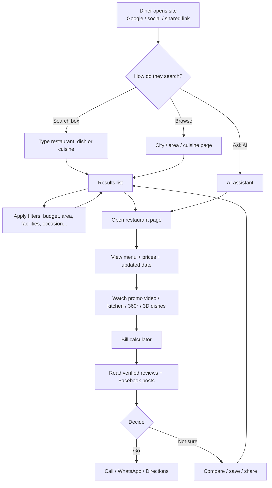
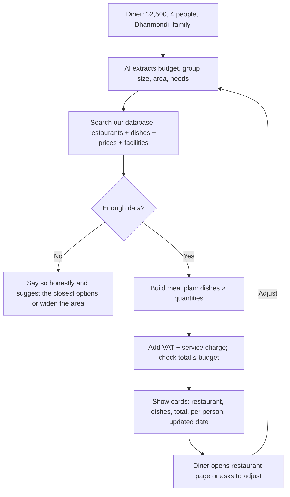
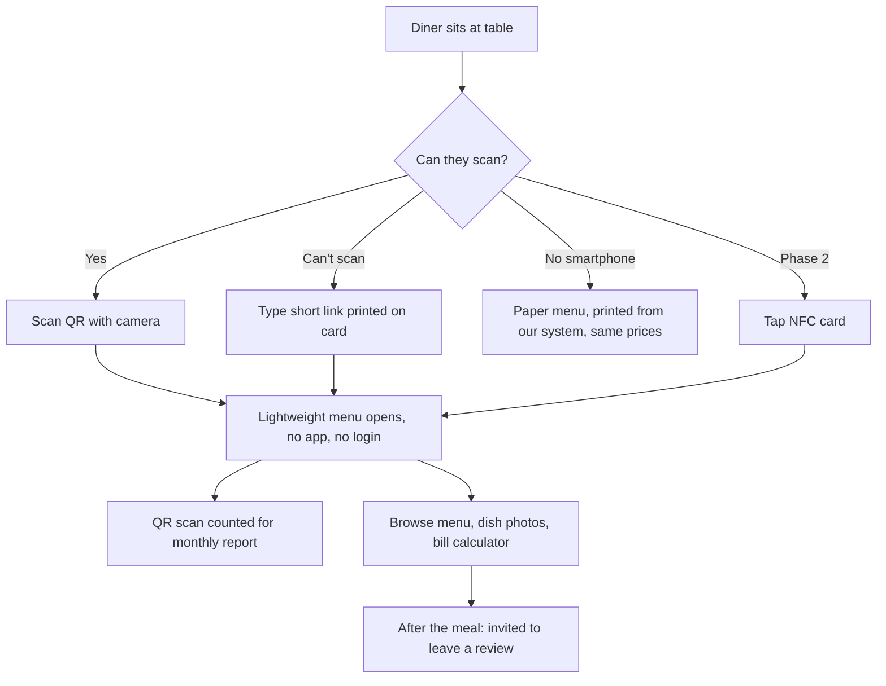
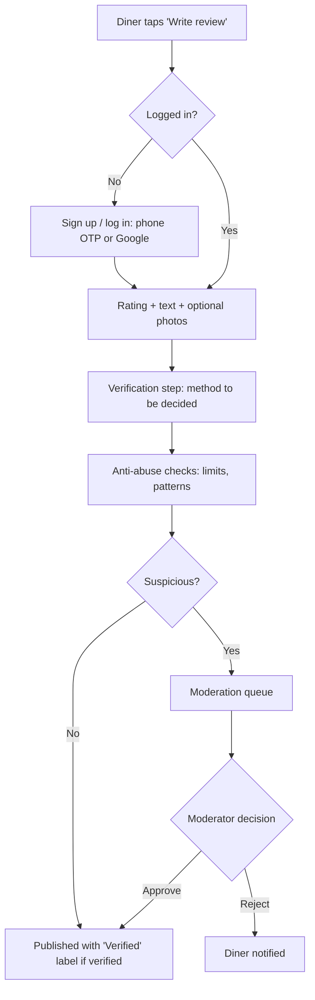
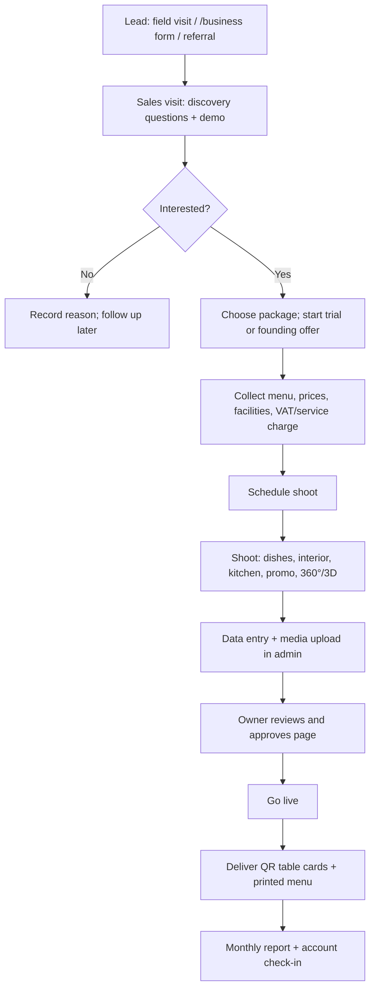
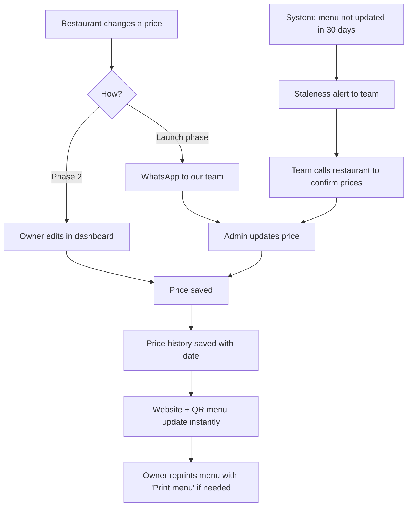
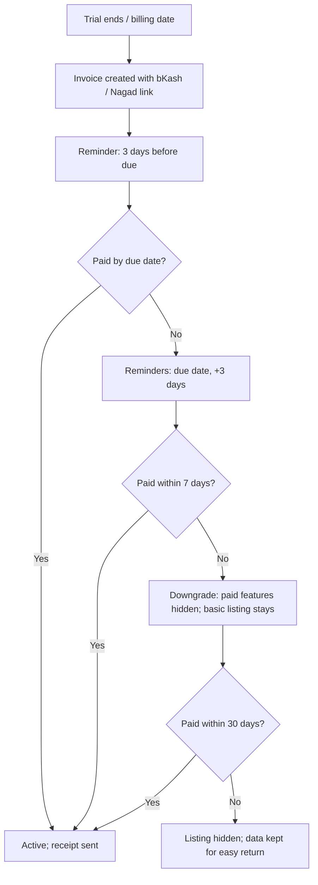
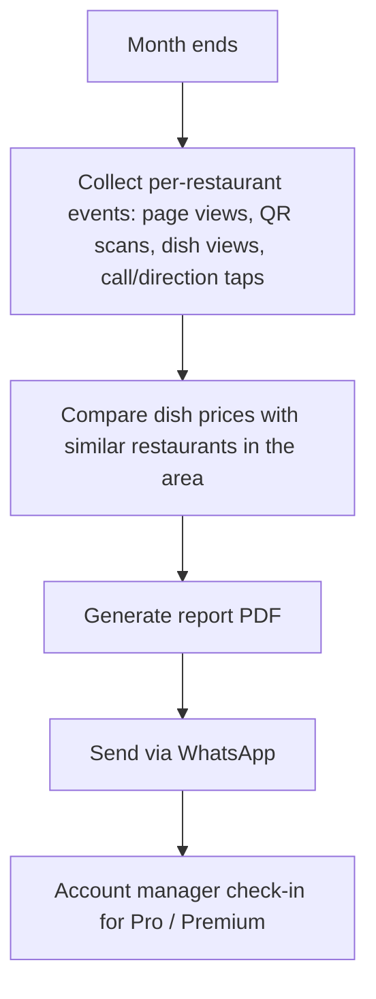

# User Flows

Diagrams use Mermaid. They render on GitHub, in VS Code (with a Mermaid extension) and in most Markdown viewers.

---

## Flow 1: Diner finds a restaurant (before the visit)

## Flow 2: AI budget planning

## Flow 3: QR menu at the table

## Flow 4: Diner writes a review

## Flow 5: Restaurant onboarding (sales → live)

## Flow 6: Menu / price update

## Flow 7: Billing cycle

*Grace periods are proposals; see [Billing Logic](13-business-billing-logic.md).*

## Flow 8: Monthly report

