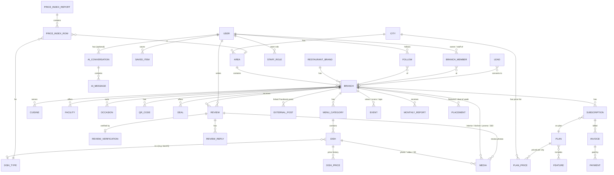

# ERD: Conceptual Data Model

This is the **conceptual** model: what we store and how it connects. The physical schema (exact column types, indexes) comes after the tech stack is chosen.

---

## 1. Key design choices
- **Brand vs Branch:** a restaurant *brand* (e.g. a chain) can have several *branches* (locations). Menus, prices, QR codes, subscriptions and reviews belong to the **branch**, because prices and quality can differ by location.
- **Price history:** prices are never overwritten; every change creates a new `DISH_PRICE` row with a date. This powers "updated X days ago", competitor insights and the Food Price Index.
- **Bilingual text:** names and descriptions are stored in both Bangla and English.
- **Media in one table:** photos, videos, 360° tours and 3D models share one `MEDIA` table with a `type` and capture date.
- **Events table:** page views, QR scans, dish views and call/direction taps are logged per branch for reports.
- **Plans drive features:** features are linked to plans, not hard-coded.

---

## 2. Diagram

---

## 3. Entities

### Locations
| Entity | Key fields |
|---|---|
| **CITY** | id, name_bn, name_en, slug, active |
| **AREA** | id, city_id, name_bn, name_en, slug |

### Restaurants & menus
| Entity | Key fields |
|---|---|
| **RESTAURANT_BRAND** | id, name_bn, name_en, slug, logo (square, for the QR centre and map), monogram (2–3 letters, used when there is no logo), theme_deep_colour, theme_accent_colour, display_font (sans/serif), description |
| **BRANCH** | id, brand_id, area_id, slug, address, lat/lng (pinned by the team at onboarding, see PRD "Location accuracy"), location_verified_at, phone, whatsapp, hours, price_per_person, vat_percent, service_charge_percent, capacity, status, founding_partner, menu_last_verified_at |
| **MENU_CATEGORY** | id, branch_id, name_bn, name_en, sort_order |
| **DISH** | id, category_id, dish_type_id (optional), name_bn, name_en, description, portion_size, serves, spice_level, is_veg, is_available, menu_format (photo/video/3d) |
| **DISH_PRICE** | id, dish_id, price, effective_from, changed_by, source (whatsapp/dashboard/visit) |
| **DISH_TYPE** | id, name (e.g. kacchi, chicken biryani, beef tehari): standard dishes used for search grouping and the Price Index |
| **MEDIA** | id, owner_type (branch/dish/review), owner_id, type (photo/video/promo/kitchen/tour_360/model_3d), url, thumbnail, captured_at, credit, sort_order |

### Classification
| Entity | Key fields |
|---|---|
| **CUISINE** | id, name_bn, name_en, slug |
| **FACILITY** | id, name_bn, name_en, icon (family cabin, prayer room, parking, AC, kids' area, wheelchair, generator, rooftop…) |
| **OCCASION** | id, name_bn, name_en (family dinner, birthday, iftar, date, office party) |
| Join tables | BRANCH_CUISINE, BRANCH_FACILITY, BRANCH_OCCASION |

### QR & deals
| Entity | Key fields |
|---|---|
| **QR_CODE** | id, branch_id, short_code, type (table_card/nfc), label (e.g. table 5), created_at |
| **QR_STYLE** | id, brand_id (one style per brand, branches can override), look (classic/rounded/dots/leaf/diamond/lines), module_shape, eye_shape, code_colour, eye_colour, use_logo (yes/no), scan_tested_at, scan_tested_by. Colours must stay dark on white; the logo forces error correction H (PRD Q-8) |
| **DEAL** | id, branch_id, title_bn, title_en, details, start_at, end_at, status |
| **PLACEMENT** | id, branch_id, type (featured/deal_of_week), city_id, area_id, cuisine_id, start_at, end_at |

### Reviews & social
| Entity | Key fields |
|---|---|
| **REVIEW** | id, branch_id, user_id, rating, text, status (pending/published/rejected), is_verified, created_at |
| **REVIEW_VERIFICATION** | id, review_id, method (*to be decided*), evidence_ref, verified_at |
| **REVIEW_REPLY** | id, review_id, author_user_id, text, created_at |
| **EXTERNAL_POST** | id, branch_id, platform (facebook), post_url, embed_status, submitted_by, approved_by, status |

### Users & roles
| Entity | Key fields |
|---|---|
| **USER** | id, name, phone, email, auth_provider, language, created_at |
| **SAVED_ITEM** | id, user_id, item_type (branch/dish), item_id |
| **FOLLOW** | id, user_id, branch_id |
| **BRANCH_MEMBER** | id, user_id, branch_id, role (owner/manager) |
| **STAFF_ROLE** | id, user_id, role (admin/sales/content/data_entry/moderator) |

### Billing
| Entity | Key fields |
|---|---|
| **PLAN** | id, code (starter/pro/premium), name |
| **PLAN_PRICE** | id, plan_id, city_id, period (monthly/quarterly/annual), amount |
| **FEATURE** | id, code (promo_video, tour_360, model_3d, featured_placement…) |
| **PLAN_FEATURE** | plan_id, feature_id, limit (e.g. social posts per month) |
| **SUBSCRIPTION** | id, branch_id, plan_id, status (trial/active/past_due/downgraded/suspended/cancelled), period, price_locked, trial_ends_at, current_period_end, commitment_ends_at |
| **INVOICE** | id, subscription_id, number, amount, discount, setup_fee, due_date, status |
| **PAYMENT** | id, invoice_id, method (bkash/nagad/bank/cash), transaction_id, amount, confirmed_by, confirmed_at |

### Analytics, reports & AI
| Entity | Key fields |
|---|---|
| **EVENT** | id, branch_id, dish_id (optional), type (page_view/qr_scan/dish_view/call_tap/direction_tap/share), source (search/qr/ai/social), created_at |
| **MONTHLY_REPORT** | id, branch_id, month, metrics (summary), competitor_insights, file_url, sent_at |
| **AI_CONVERSATION** | id, user_id (optional), session_id, created_at |
| **AI_MESSAGE** | id, conversation_id, role, text, results_shown, created_at (anonymised for analysis) |
| **PRICE_INDEX_REPORT** | id, city_id, month, published_at |
| **PRICE_INDEX_ROW** | id, report_id, dish_type_id, area_id, avg_price, median_price, sample_size, change_pct |

### Sales
| Entity | Key fields |
|---|---|
| **LEAD** | id, restaurant_name, area_id, contact_name, phone, source (visit/form/referral), stage, owner_staff_id, notes, next_follow_up |

---

## 4. Open points
- Review verification fields depend on the chosen method.
- Language handling (separate columns vs translation table) depends on the tech stack.
- Event storage may move to an analytics tool at scale.
